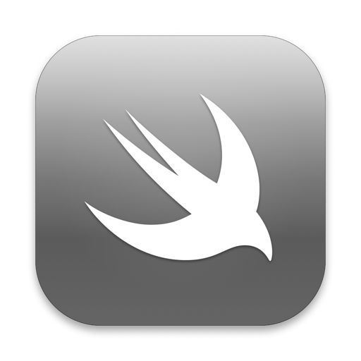
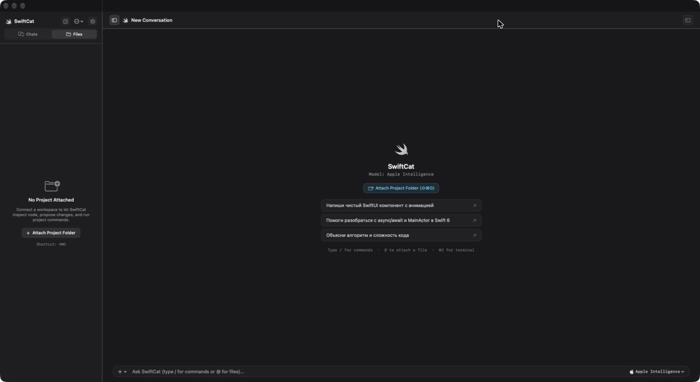
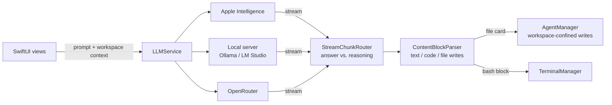

<div align="center">



# SwiftCat

**A native macOS AI coding assistant with a built-in terminal.**<br>
Chat with a model, review its proposed file changes as diffs, and apply them with one click.

[](https://github.com/infarmor/SwiftCat/actions/workflows/ci.yml)
[](LICENSE)




</div>

## Why SwiftCat

Most AI coding tools are web views in disguise. SwiftCat is plain SwiftUI: it launches instantly, feels like a Mac app, and talks to whichever model you prefer, from the one already on your Mac to a cloud API.

- **Your model, your call.** Apple Intelligence runs on-device with nothing to set up. Point it at Ollama, LM Studio or llama.cpp for local models, or use OpenRouter for cloud ones.
- **Changes you can review.** Proposed edits arrive as cards with a line diff. Nothing touches disk until you press Apply.
- **Confined to your project.** File writes are limited to the folder you attach; paths that try to escape it are rejected.

## Features

| | |
| --- | --- |
| **Three backends** | Apple Intelligence (FoundationModels), any OpenAI-compatible local server, and OpenRouter. |
| **Workspace-aware** | Attach a project folder; the model sees the file tree and any files you mention. |
| **`@file` mentions** | Type `@` to attach a file to your message. |
| **Diff review** | Each `<write_file>` block becomes a card with Code and Diff views and an Apply button. |
| **Integrated terminal** | Run the shell commands from a reply with one click. Output streams live and can be stopped. |
| **Reasoning view** | `<think>` blocks and dedicated reasoning fields are shown apart from the answer. |
| **Rich replies** | Markdown, syntax-highlighted code blocks, copy and regenerate, edit a sent message. |
| **Slash commands** | `/git`, `/diff`, `/files`, `/agent`, `/clear`. |
| **Private by default** | History is a JSON file in `~/Library/Application Support/SwiftCat/`. No telemetry. |

## Quick start

You need macOS 26 or later and Xcode 26 or later.

```bash
git clone https://github.com/infarmor/SwiftCat.git
cd SwiftCat
swift run SwiftCat
```

To build an app bundle and install it into `~/Applications`:

```bash
./build_app.sh
open ~/Applications/SwiftCat.app
```

### Choosing a model

Open Settings with `⌘,`.

| Backend | Setup |
| --- | --- |
| **Apple Intelligence** | Nothing to configure. Needs Apple Intelligence enabled on your Mac. |
| **Local server** | Set the endpoint (default `http://localhost:11434/v1` for Ollama). Installed models are detected automatically. |
| **OpenRouter** | Paste your API key, then add the model slugs you want. |

> The OpenRouter key is currently stored in the app's preferences rather than the Keychain. See the [roadmap](#roadmap).

## Keyboard shortcuts

| Shortcut | Action |
| --- | --- |
| `⌘N` | New conversation |
| `⌘K` | Clear the current conversation |
| `⌘.` | Stop generating |
| `⌘J` | Toggle the terminal |
| `⌘\` | Toggle the sidebar |
| `⇧⌘O` | Attach a project folder |
| `⌘,` | Settings |
| `⌥↩` | Line break in the input (`↩` sends) |

## How it works



```
Sources/SwiftCat/
  LLMService.swift          model backends and streaming
  StreamChunkRouter.swift   splits reasoning from the answer as it streams
  MessageRendering.swift    reply parsing and Markdown
  AgentManager.swift        workspace, file reading and safe writes
  TerminalManager.swift     command execution
  ConversationStore.swift   history persistence
  Views/                    SwiftUI views
Tests/SwiftCatTests/        unit tests
docs/                       README assets
scripts/                    icon and social-preview generators
```

## Safety

- A file proposal is written only when you press Apply, unless you turn on auto-apply.
- Paths from model output are rejected if they resolve outside the attached workspace.
- The terminal runs commands as you, with your permissions. Read a command before running it.

To report a vulnerability, see [SECURITY.md](SECURITY.md).

## Development

```bash
swift build      # debug build
swift test       # run the unit tests
```

CI builds and tests every push and pull request on a macOS 26 runner. See [CONTRIBUTING.md](CONTRIBUTING.md) before opening a PR.

## Roadmap

- [ ] Store the OpenRouter key in the Keychain
- [ ] Localize the interface (some prompts and labels are currently in Russian)
- [ ] Signed and notarized release builds
- [ ] Let the model read files and run commands as tool calls, with approval

Ideas and bug reports are welcome in [issues](https://github.com/infarmor/SwiftCat/issues).

## License

[MIT](LICENSE)
